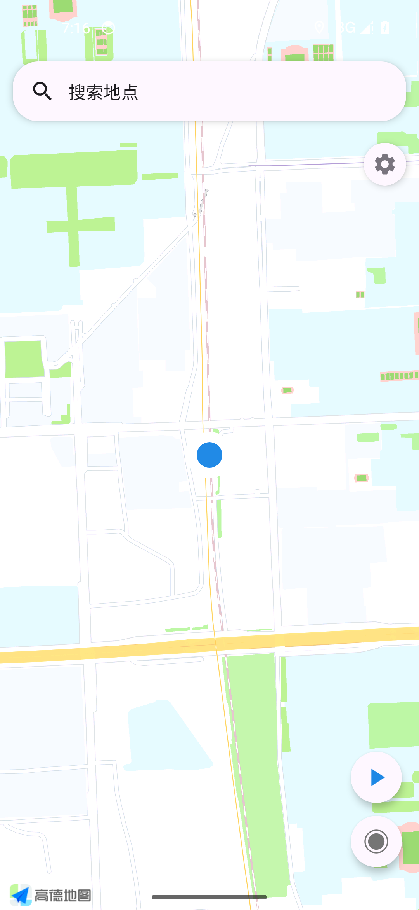
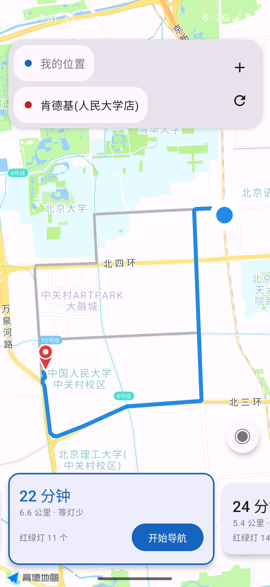
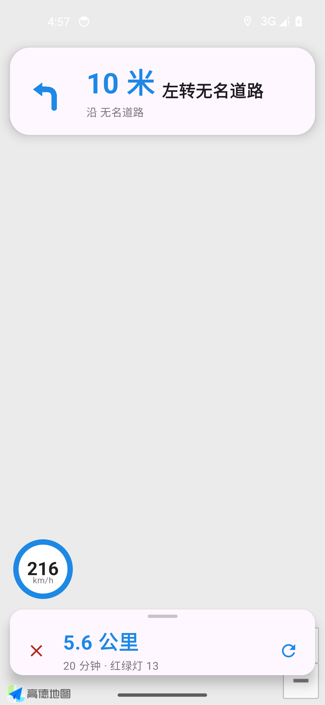
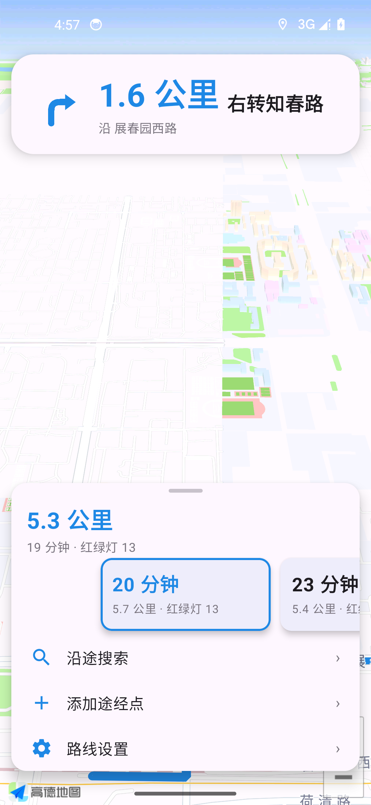
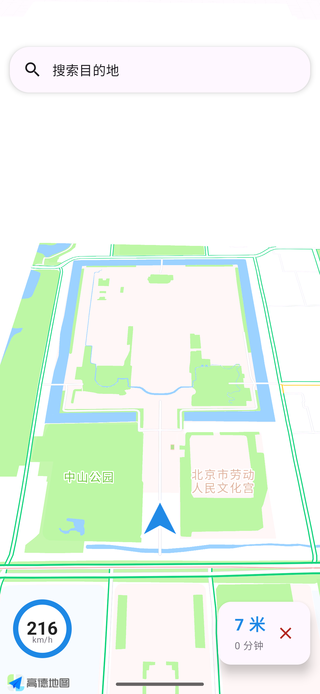
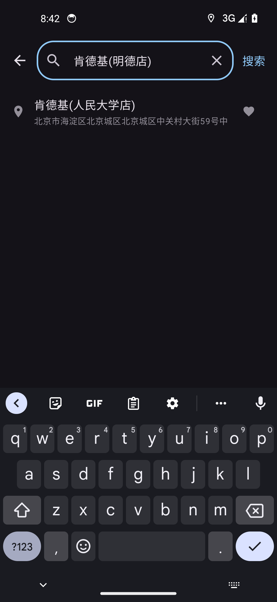

# Amapilot

开源 Android 导航应用：基于高德地图 SDK 的自研导航体验，支持 Android Auto。

不依赖高德官方导航页——TBT（Turn-By-Turn）转向界面、巡航模式、车速环、语音播报均为自研实现，手机与车机双端共用同一数据层。

## 功能

- **地图浏览**：定位三件套（精度圈 + 方向扇形 + 圆点，航向支持旋转矢量传感器）、实时路况、昼夜底图
- **搜索**：输入联想、搜索历史、POI 结果（距离排序）、收藏与常用地点（家/公司一键导航）
- **多路线导航**：默认策略可选（躲避拥堵 / 不走高速 / 高速优先等），多路线卡片切换、备选路线灰显
- **自研 TBT**：转向卡、剩余里程/时间、车速环（超速红环）、可上拉面板（路线重选 / 设置）
- **巡航模式**：无起终点跟车行驶，3D 车头朝上视角、电子眼限速提醒、行程统计、随时搜索目的地转入导航；行驶中（≥20 km/h 持续 15 秒）自动进入巡航，可在设置关闭
- **语音播报**：系统 TTS 播报引擎导航文本，电子眼/限速播报可分类开关
- **Android Auto**：Navigation Template 车机屏（转向/剩余/车速，导航与巡航两态），车机连接即自动进入巡航，支持车机端搜索并发起导航
- **分享接收**：接收第三方应用分享的位置直接发起导航，自动识别百度坐标（BD-09）并转换
- **昼夜模式**：自动（跟随系统）/ 白天 / 夜间

## 截图

| 浏览地图 | 路线选择 | TBT 导航 |
|:---:|:---:|:---:|
|  |  |  |

| TBT 面板 | 巡航模式 | 夜间搜索 |
|:---:|:---:|:---:|
|  |  |  |

## 下载

从 [Releases](../../releases) 下载 APK 侧载安装。

**需要先申请自己的高德 Key（免费，个人约 5 分钟）**：安装包不内置任何 key——首次启动会引导你完成申请（复制签名 SHA1 → 高德控制台创建 key → 粘贴回 app）。每个用户以自己的身份直接与高德缔约、使用自己的免费配额，不共享也不依赖开发者配额。

**Android Auto 注意**：AA 17.x 启动器仅放行 Play 商店安装的应用，侧载 APK（含开启"未知来源"）均无法出现在车机启动器。车机使用请参照[Play 内部测试上架指南](docs/PLAY_UPLOAD_GUIDE.md)经 Play 商店安装。

## 自行构建

**本仓库不含任何 API Key，Release 产物同样零内置 key**——高德 Key 免费但需实名申请，请使用自己的 Key。
**高德 SDK 二进制同样不入库**（高德服务协议禁止再分发开发包）——构建脚本会自动从官网下载校验。

### 1. 环境要求

- JDK 17
- Android SDK（compileSdk 36，Build Tools 最新）
- 设备/模拟器：arm64-v8a（见下方"注意事项"）

### 2. 获取高德 SDK

首次构建前运行（幂等，文件已就绪则直接跳过）：

```bash
./scripts/fetch-amap-sdk.sh
```

脚本从高德官网下载一体包 zip（3D 地图 + 导航 + 搜索 + 定位），经官方 MD5 校验后
将 jar 放入 `app/libs/`、arm64 原生库放入 `app/src/main/jniLibs/arm64-v8a/`。
网络不可用或想手动安装时，也可自行从
[高德官网下载中心](https://lbs.amap.com/api/android-sdk/download)
下载「导航合包」zip，按相同位置放置。

### 3. 申请高德 Key

1. 注册并登录[高德开放平台](https://lbs.amap.com/)
2. 控制台 → 应用管理 → 创建新应用
3. 为应用添加 Key，平台选择 **Android**
4. 发布版 SHA1 与调试版 SHA1 填**同一个**（本项目 debug/release 统一签名，见下一步生成的 keystore）

获取 SHA1：

```bash
keytool -list -v -keystore keystores/release.keystore -alias amapilot
```

### 4. 生成签名 Keystore

debug/release 共用同一 keystore（这样高德 Key 只需绑定一个 SHA1）：

```bash
keytool -genkeypair -v -keystore keystores/release.keystore -alias amapilot \
  -keyalg RSA -keysize 2048 -validity 10000
```

### 5. 配置 local.properties

仓库根目录 `local.properties`（已 gitignore）：

```properties
sdk.dir=/path/to/android-sdk
# 你自己申请的高德 Key（步骤 2）
AMAP_API_KEY=你的key
# 可选：keystore 密码与别名（与步骤 3 生成时填写的一致）
# KEYSTORE_PASSWORD=你的密码
# KEYSTORE_ALIAS=你的别名
```

### 6. 构建

```bash
./gradlew assembleDebug        # 调试包 app/build/outputs/apk/debug/
./gradlew assembleRelease      # 发布包
adb install -r app/build/outputs/apk/debug/app-debug.apk
```

### 注意事项

- **仅 arm64-v8a**：高德原生库为 ARM-only。x86_64 模拟器可跑（依赖 ARM 转译，`extractNativeLibs` 已配置），真机无影响
- 模拟器上定位可能被高德海外权益拦截，本项目已内置系统 GPS 直读方案绕开
- 首次启动需同意高德隐私政策并授予定位权限

## 技术栈

- Kotlin · Jetpack Compose（Material 3）· MVVM
- 高德地图 Android SDK（3D 地图 + 导航引擎）
- androidx.car.app 1.7.0（Android Auto Navigation Template）
- minSdk 26（Android 8.0）/ targetSdk 36

## 许可

[Apache-2.0](LICENSE)。本项目与高德开放平台无隶属或背书关系；高德地图 SDK 的使用受
[高德开放平台服务协议](https://lbs.amap.com/home/terms/)约束（构建时自行下载，需自行接受其条款）。

## 贡献

欢迎 issue 与 PR：见[贡献指南](CONTRIBUTING.md)；安全漏洞请走[私有上报渠道](SECURITY.md)。
